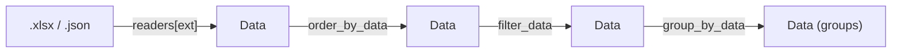

# User guide

pyrecords works on one shape of data:

```python
from pyrecords import Data, DataItem

row: DataItem = {"name": "Rama", "city": "Homs", "age": 28}  # dict[str, Any]
data: Data = [row]  # list[dict[str, Any]]
```

`Data` and `DataItem` are type aliases, so any list of dicts works; you do not need to wrap
anything.

The usual flow is **read → order → filter → group**, each step a function that takes a
`Data` and returns a new `Data`:



| Page | Covers |
| --- | --- |
| [Reading files](reading.md) | `readers`, `object_readers`, Excel and JSON rules |
| [Ordering](ordering.md) | `OrderByKey`, `order_by_data`, empty values |
| [Filtering](filtering.md) | filter JSON, `all` / `any`, `inverse`, value conversion |
| [Grouping](grouping.md) | `group_by_data`, several keys, `items_key` |
| [Extending](extending.md) | adding a reader for a new extension, adding a filter rule |
